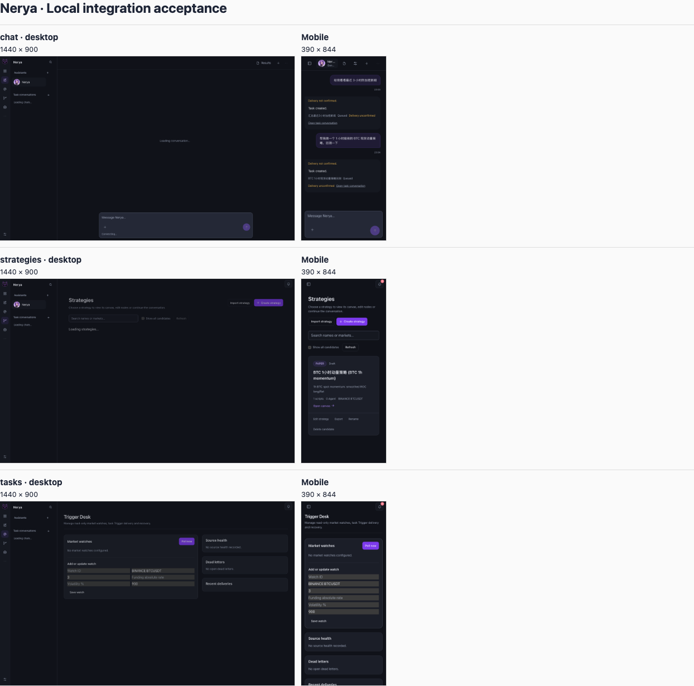

# PR #30 + #31 合并验收 · 2026-11-08

**结论：保留集成分支，不合入 main。** 共同基线 `85a30d0` 的 Truth Gate 是绿色。`3614559` 是两方真实 PR 头的双亲合并；`9afe3ed` 和 `c0fd751` 是修复提交。#30（`42a28a7`）主要做持久任务控制、订阅与触发准入；#31（`2ad0ff4`）扩展任务交付、策略创建、历史回放及证据展示。不是把两套实现简单叠加。

## 真实业务场景

隔离工作区、真实模型、paper-only。未启用实盘，也没有下单。浏览器从聊天页发起中文请求；以子任务和保存的产物作为证据，不以父会话的“已受理”代替结果。

| 场景 | 验收证据 | 判定 |
|---|---|---|
| 最近三小时加密新闻 | `acmd_1299eb3f3da961501a55696a` 正常结束。回复有 6 个不同的文章链接，6/6 均在本地已保存抓取中匹配；一条未能展示，回复披露了局限。未独立复核新闻报道本身。 | 链路通过 |
| BTC 现货 1 小时动量策略 | `acmd_ef424c8ec601e2c02d7376ca` 写出了 `prp_5e310202559a/after/strategies/btc_1h_momentum/strategy.yml`、代码和测试；桌面/手机策略列表均能看到候选。 | 创建草稿通过 |
| 同一个候选的回测 | macOS 沙箱修复后，针对该候选重新做隔离校验：结构通过，行为测试 2/4 通过。无信号时的原因与断言不一致；另一路径实际 `rejected`、预期 `hold`。没有可核验的历史 `metrics.json` 或回测报告，验收结束时中断此测试任务。 | **不通过** |
| 页面 | Chromium 在 1440×900、390×844 检查聊天、策略和 Trigger Desk：6/6 返回 200，无文档级横向溢出或未捕获的页面异常。这不是所有页面或浏览器的视觉覆盖。 | 抽查通过 |

## 修复和回归

- 脚本按实际执行模式做实盘准入，Agent 入队前也检查。未声明模式的实盘策略不能绕过准入，事件指定一个账户不能缩小多账户策略的实际权限。
- 修复刷新后丢失交付状态和新命令误继承旧证据的显示问题；复用 EN/ZH 资源。E2E 使用正式本机 socket 入口，独立启动的服务共享随机内部凭据；没有移除鉴权。
- 对明确提供的策略清单、提交与回放恢复请求约束检查；已绑定请求的回放不能把范围匹配降级为可选。收窄对变更指令的识别，普通价格变化和否定命令不再自动被当作用户的变更请求。`request_scope.py` 仍有按中英文措辞解释上下文的路径，**没有**宣称已消除所有硬路由。
- macOS Seatbelt 将 SDK 路径按字面值匹配，并单独限制 `.py` 文件。真实沙箱测试证明：含点号、空格、方括号、连字符的 checkout 可读 SDK 源文件；同目录 JSON、相邻目录 Python 文件仍不可读。

| 验证 | 结果 |
|---|---|
| Dashboard | TypeScript、i18n、生产构建通过；Node 723/723；lint 无错误，有警告。 |
| 后端专项 | 投研、范围错配、任务、交付、图表和实盘准入 120/120；macOS 沙箱/隔离执行/回测生命周期 75 通过、1 跳过；另补路径隔离用例通过。Python `ruff --select F` 通过。 |
| 首轮本地全量（联调起点，非最终提交的全量结果） | 8068 通过、687 失败、44 错误、22 跳过。 |
| 对前轮 731 个失败/错误项的重跑（最后一轮沙箱修复前） | 98 通过、588 失败、45 错误。不能从这组结果推算最终全量。 |
| 最终代码 `c0fd751` 的阻塞专项 | `test_question_answer_completes_unspecified_resource_without_persisting_empty_prefix`、`test_scope_pinned_window_restatement.py` 和 `test_lp_policy_replay.py`：**108 通过、5 失败、24 错误**。覆盖对话澄清、已确认窗口/周期的恢复、LP 回放产物。 |

原有四个浏览器 smoke/场景用例没有转绿：其中首次运行的按钮被分离启动环境的鉴权阻断；后续用例把父会话与子任务的完成边界混在一起。以上“真实业务”是另行核验的子任务、落盘文件和浏览器证据，不是把这些失败计为通过。

## 开放合并门槛

在同一候选上从普通用户会话走通创建、验证和真实历史回测，保留指标、报告及输入来源。恢复已确认市场/周期的多轮对话测试和 LP 产物校验；将不再适用的老断言与产品回归分别处理。再跑完整 Truth Gate，不能采用跳过测试、允许假行情或关闭权限检查的方式合并。
